# PeopleHub – Three-Tier AWS Cloud Deployment

## 1. Project Overview

PeopleHub is a cloud-based employee management application deployed on Amazon Web Services (AWS). The project demonstrates a three-tier architecture using AWS networking, compute, container orchestration, database services, CI/CD automation, infrastructure as code, security services, and monitoring tools.

The infrastructure is designed across two Availability Zones (AZs) to improve availability and reduce the impact of an individual AZ failure.

The application uses:
- **Frontend:** Deployed on Amazon EC2.
- **Backend:** Containerized Node.js application deployed on Amazon EKS.
- **Database:** Amazon RDS MySQL with a read replica.
- **CI/CD:** Jenkins with separate frontend and backend build pipelines.
- **Infrastructure as Code:** Terraform.
- **Container Registry:** Amazon ECR.
- **DNS and CDN:** Amazon Route 53 and Amazon CloudFront.
- **Security:** AWS WAF, ACM, IAM, Security Groups and Network ACLs.
- **Monitoring:** Amazon CloudWatch and Grafana Cloud.
  
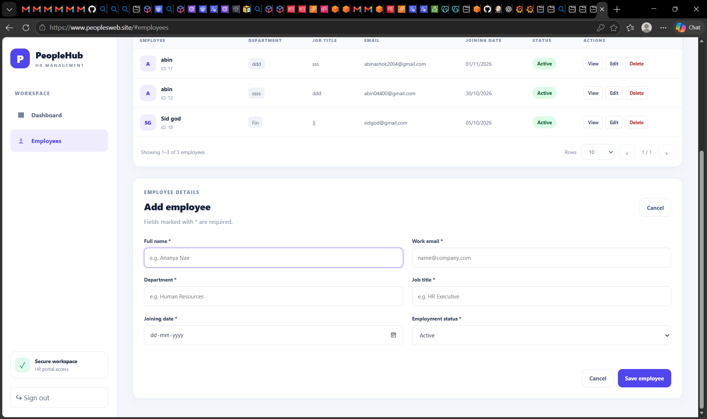
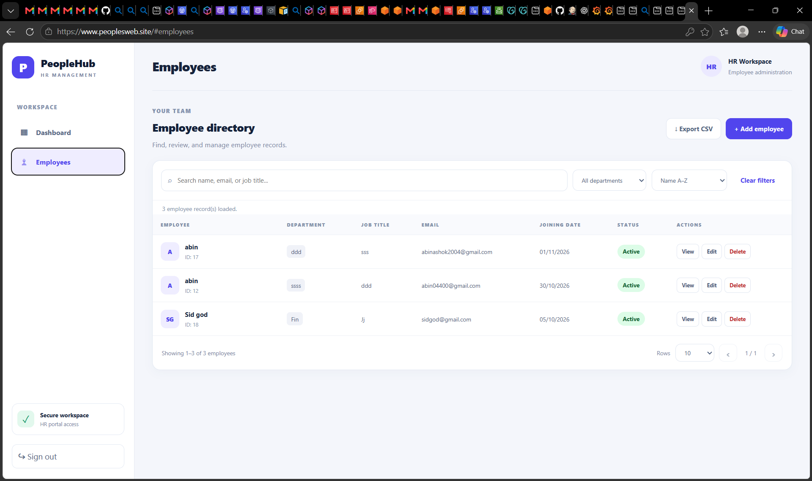
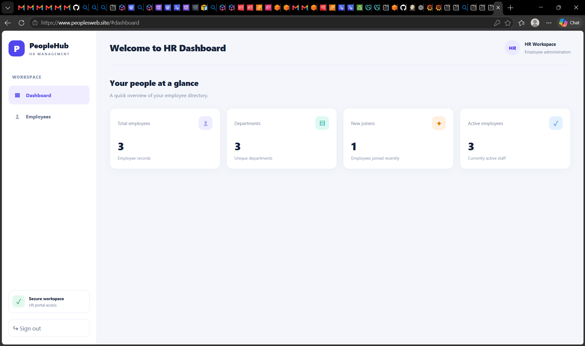
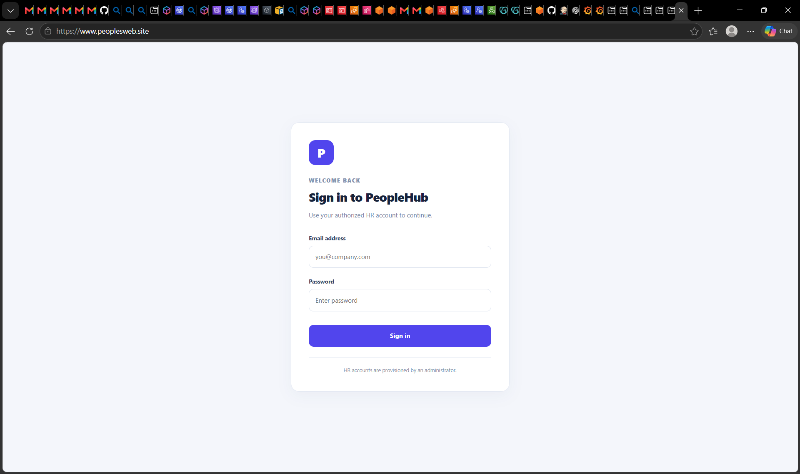

## 2. Architecture Overview

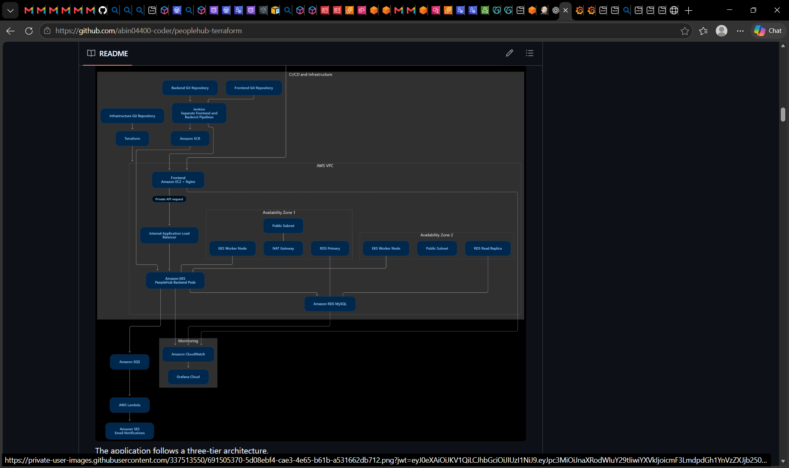

The application follows a three-tier architecture.

### Tier 1 – Presentation Layer

The frontend is deployed on an Amazon EC2 instance.

Components:
- Amazon EC2 hosts the frontend application.
- Nginx serves the frontend and handles reverse proxy configuration.
- CloudFront distributes application content.
- AWS WAF protects the CloudFront distribution.
- AWS Certificate Manager provides HTTPS certificates.
- Route 53 manages DNS records for the application domain.

The domain is registered with GoDaddy. A Route 53 hosted zone is created for the domain, and its nameservers are configured in GoDaddy so that Route 53 manages DNS resolution.

### Tier 2 – Application Layer

The backend is deployed on Amazon Elastic Kubernetes Service (EKS).

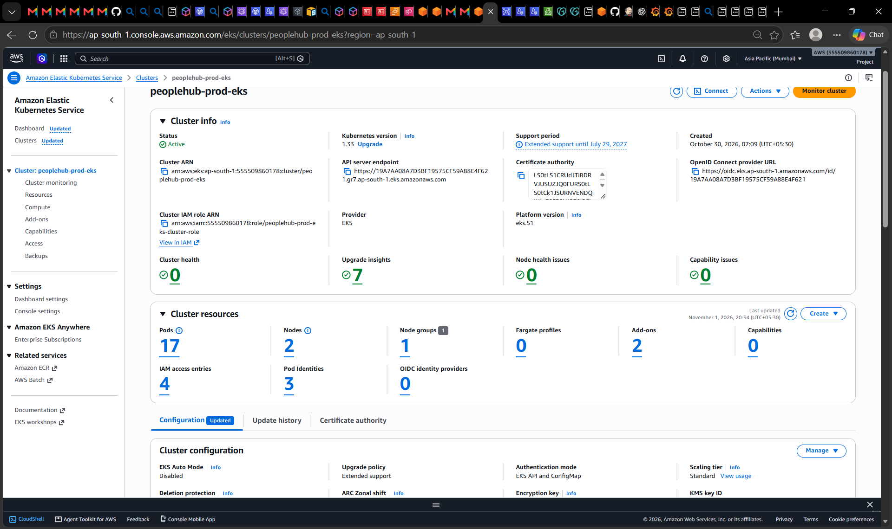

Components:
- Amazon EKS manages the Kubernetes cluster.
- Backend Docker images are stored in Amazon ECR.
- AWS Application Load Balancer Controller manages Kubernetes Ingress resources.
- An internal Application Load Balancer routes traffic to the backend services.
- Backend pods run in the `peoplehub` Kubernetes namespace.
- Kubernetes Services distribute requests to backend pods.
- Horizontal Pod Autoscaler supports application scaling.
- Amazon SQS handles asynchronous messaging.
- AWS Lambda processes SQS messages.
- Amazon SES sends email notifications.

The frontend communicates with the backend through the internal ALB using the configured API proxy.

### Tier 3 – Database Layer

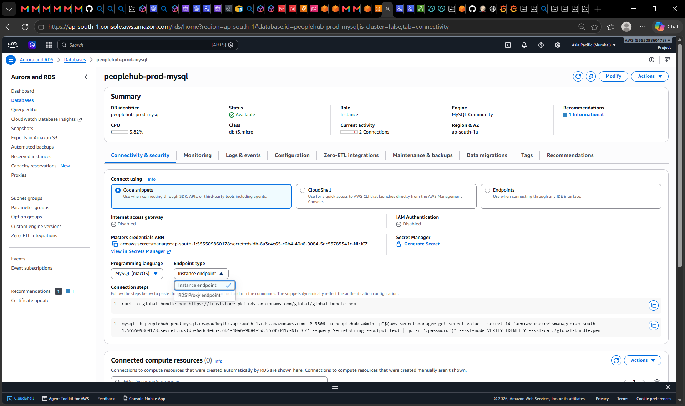

Amazon RDS MySQL provides persistent application data storage.

Components:
- RDS MySQL primary database.
- RDS read replica for read scaling and an additional database copy.
- Database resources are distributed across the planned Availability Zones.
- Database access is restricted through network security rules.

The database is not intended to be publicly accessible.

## 3. AWS Services Used

| Service | Purpose |
|---|---|
| Amazon VPC | Provides isolated cloud networking |
| Public and private subnets | Separates public-facing and internal resources |
| Internet Gateway | Provides internet connectivity for public subnets |
| NAT Gateway | Allows private subnet resources to access the internet |
| Route Tables | Control network traffic routing |
| Amazon EC2 | Hosts the frontend |
| Amazon EKS | Runs containerized backend workloads |
| Amazon ECR | Stores frontend and backend Docker images |
| Application Load Balancer | Routes incoming application traffic |
| Internal ALB | Routes private traffic to EKS backend services |
| Amazon RDS MySQL | Stores application data |
| RDS Read Replica | Supports read scaling |
| Amazon SQS | Provides asynchronous message processing |
| AWS Lambda | Processes queued messages |
| Amazon SES | Sends email notifications |
| Amazon CloudFront | Content delivery and application distribution |
| Amazon Route 53 | DNS hosting and domain routing |
| AWS Certificate Manager | Manages SSL/TLS certificates |
| AWS WAF | Protects the CloudFront distribution |
| AWS IAM | Controls permissions and service access |
| Amazon CloudWatch | Collects AWS metrics and logs |
| Grafana Cloud | Provides dashboards and monitoring |
| Jenkins | Automates CI/CD pipelines |
| Terraform | Provisions and manages infrastructure |

## 4. Domain, DNS and HTTPS Configuration

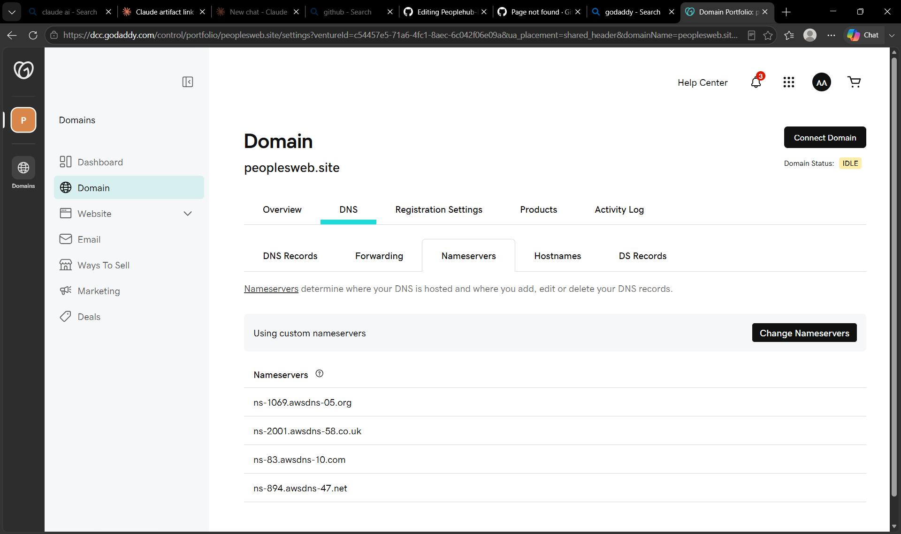
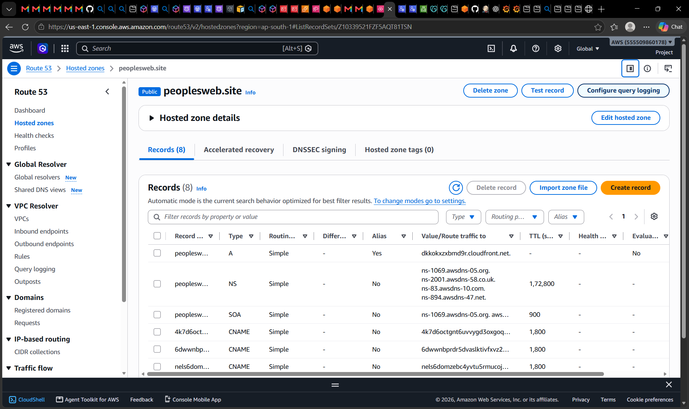

The project uses a custom domain registered through GoDaddy.

The DNS and HTTPS setup follows this flow:

1. Register the domain through GoDaddy.
2. Create a public hosted zone in Amazon Route 53.
3. Copy the Route 53 nameservers.
4. Update the domain's nameserver records in GoDaddy.
5. Create the required DNS records in Route 53.
6. Request and validate an SSL/TLS certificate through AWS Certificate Manager.
7. Configure the certificate with CloudFront.
8. Configure AWS WAF to protect the CloudFront distribution.
9. Route application traffic through CloudFront to the configured origin.

**Important:** CloudFront certificates must be requested or imported in the `us-east-1` AWS region.

## 5. High Availability and Disaster Recovery

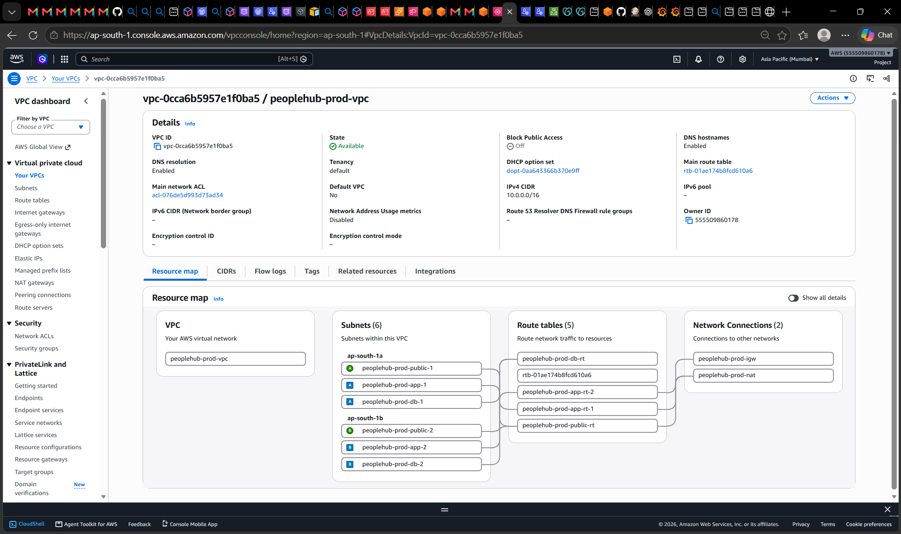

The infrastructure is designed around two Availability Zones.

The design includes:
- Resources distributed across two AZs where supported.
- Public and private subnet separation.
- NAT Gateway connectivity for private resources.
- EKS worker capacity across the AZs.
- RDS primary database and read replica.
- Load balancing for application traffic.

The read replica provides an additional database copy and can support read scaling. It should not be treated as an automatic disaster recovery failover unless replication, promotion, and recovery procedures are configured.

Similarly, two-AZ deployment improves availability but does not by itself guarantee complete disaster recovery. Recovery procedures, backups, restore testing, and documented recovery objectives are also important.

## 6. CI/CD Pipeline Using Jenkins

Jenkins is used to automate application builds and deployments.

The project uses **three separate Git repositories**, rather than a single monolithic repository.

| Repository | Responsibility |
|---|---|
| Frontend repository | Frontend application source code |
| Backend repository | Backend application source code |
| Infrastructure repository | Terraform configuration and infrastructure manifests |

### Frontend CI/CD Pipeline

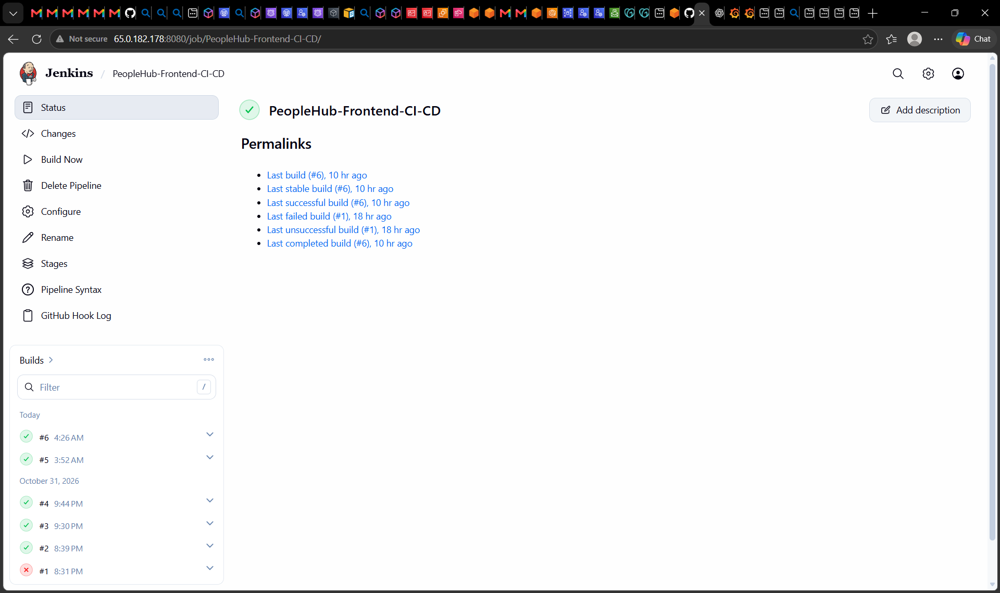
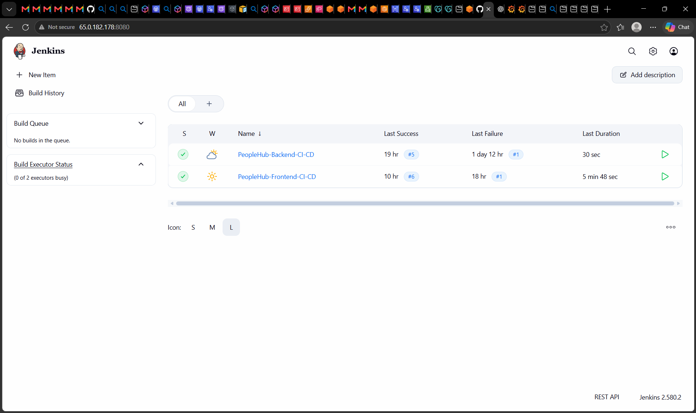

1. Developer pushes frontend code to the frontend Git repository.
2. Jenkins detects the code change.
3. Jenkins checks out the source code.
4. Dependencies are installed.
5. Frontend build is executed.
6. Docker image is built if using a containerized frontend deployment.
7. Image is pushed to Amazon ECR if applicable.
8. Frontend EC2 deployment is updated.

### Backend CI/CD Pipeline

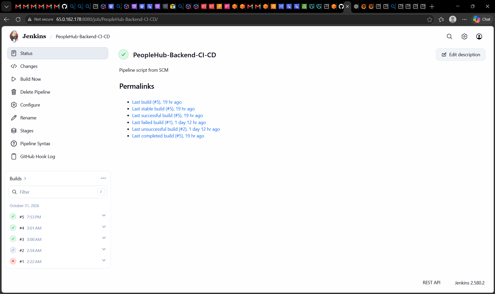

1. Developer pushes backend code to the backend Git repository.
2. Jenkins detects the code change.
3. Jenkins checks out the backend source code.
4. Dependencies are installed.
5. Application tests and build checks are executed.
6. Docker image is built.
7. Image is pushed to Amazon ECR.
8. Kubernetes deployment is updated on Amazon EKS.
9. Deployment and pod status are verified.

### Infrastructure CI/CD Pipeline

The separate infrastructure repository contains Terraform code.

The workflow includes:
1. Developer updates Terraform configuration.
2. Jenkins checks out the infrastructure repository.
3. Terraform formatting and validation are executed.
4. Terraform plan is generated.
5. Changes are reviewed and approved.
6. Terraform apply provisions or updates AWS resources.

Infrastructure changes should be reviewed before applying them to production.

## 7. Infrastructure as Code – Terraform

Terraform is used to provision and manage AWS infrastructure.

The infrastructure repository manages the required AWS resources, such as:

- VPC and networking components.
- Public and private subnets.
- Internet Gateway and NAT Gateway.
- Route tables.
- Security Groups and Network ACLs.
- EC2 resources.
- EKS cluster and worker nodes.
- IAM roles and policies.
- RDS database resources.
- Supporting AWS services.

Terraform helps maintain repeatable infrastructure deployments and makes infrastructure changes easier to review and manage.

## 8. Containerization and Amazon ECR

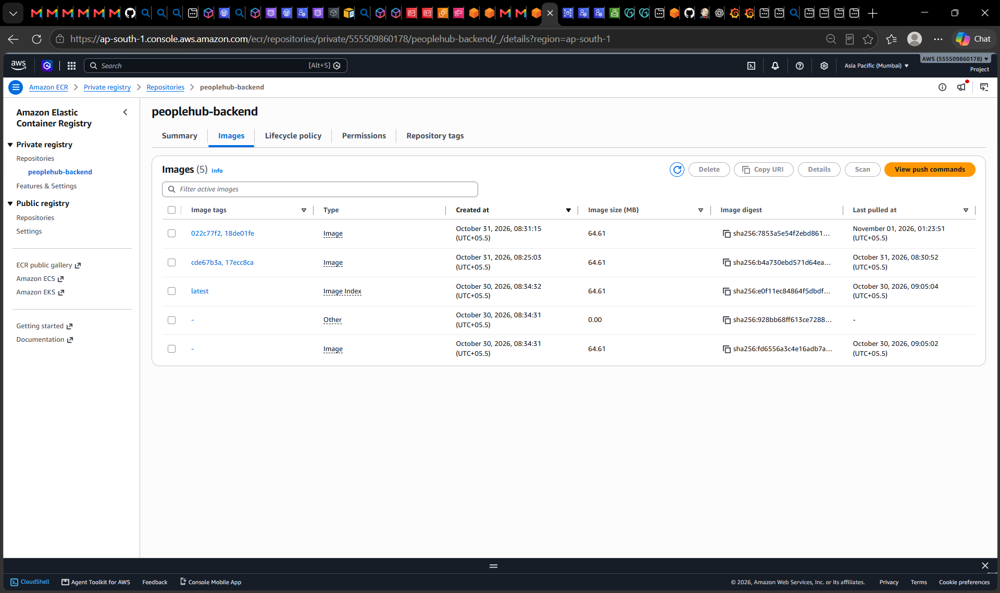
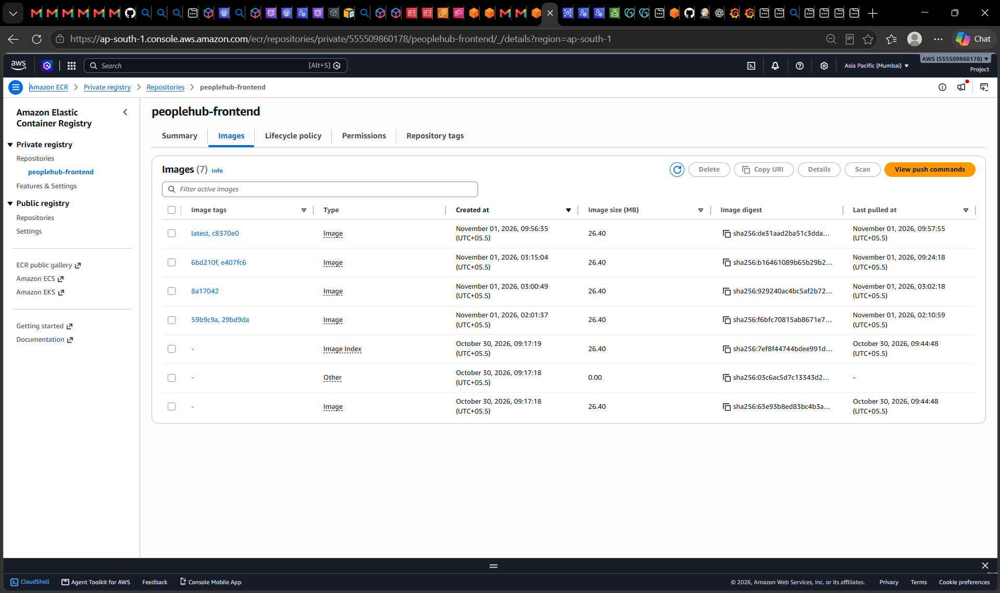

Docker is used to package the application components.

Amazon ECR stores the application container images.

Separate repositories are maintained for the frontend and backend images.

Example repository names:

- `peoplehub-frontend`
- `peoplehub-backend`

Jenkins builds and pushes the images to ECR as part of the respective CI/CD pipelines.

Amazon EKS pulls the backend image from ECR to run the application containers.

## 9. Asynchronous Processing – SQS, Lambda and SES

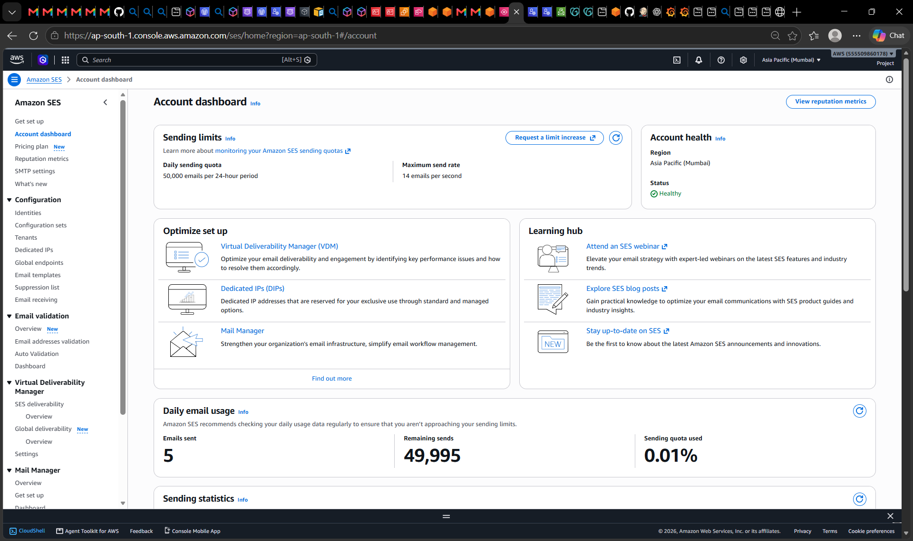
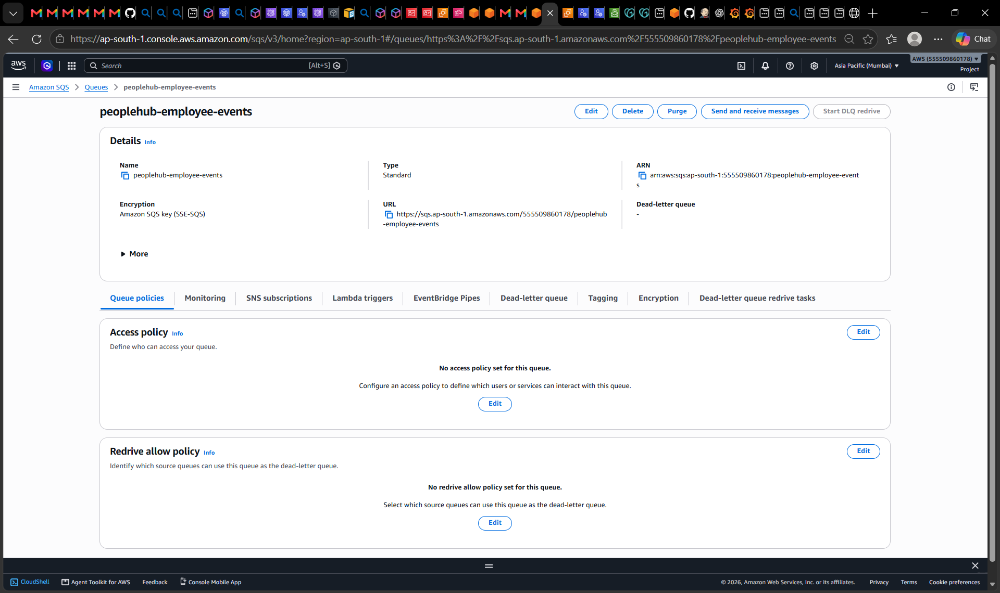
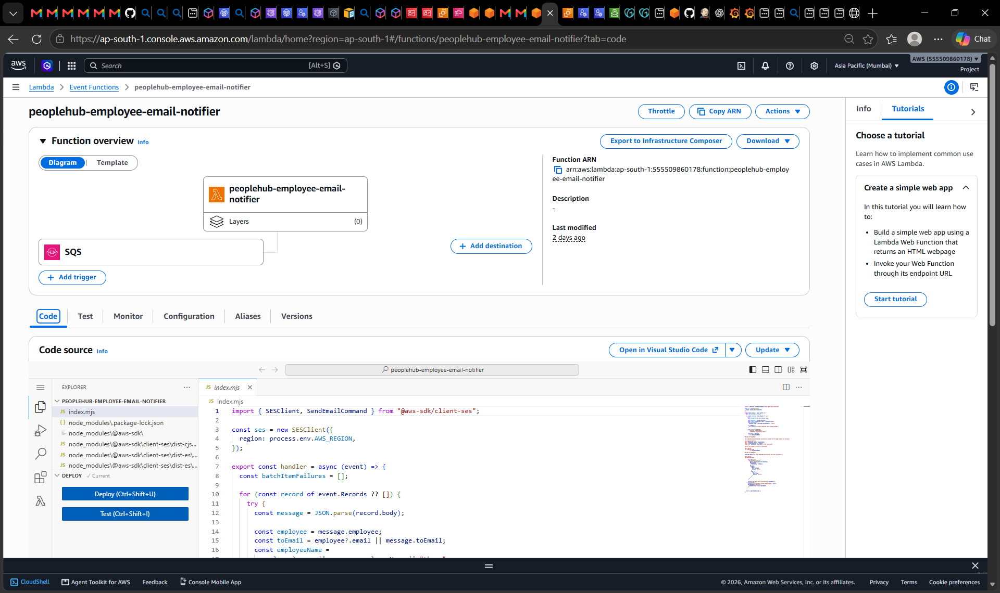

The project uses an event-driven workflow for email notifications.

The process is:

1. A user performs an employee-related operation.
2. The backend sends an event to Amazon SQS.
3. AWS Lambda receives and processes the queued event.
4. Lambda invokes Amazon SES.
5. SES sends the required email notification.

This separates email processing from the main API request and supports asynchronous processing.

## 10. Security Implementation

Security is implemented at multiple layers.

### Network Security

- Public and private subnet separation.
- Security Groups to control instance, ALB, EKS and database traffic.
- Network ACLs for subnet-level traffic filtering.
- Private database connectivity.
- Internal ALB for private backend access.

Security Groups are stateful, while Network ACLs are stateless. Both can be used together, with Security Groups providing the primary resource-level access controls.

### Application and Edge Security

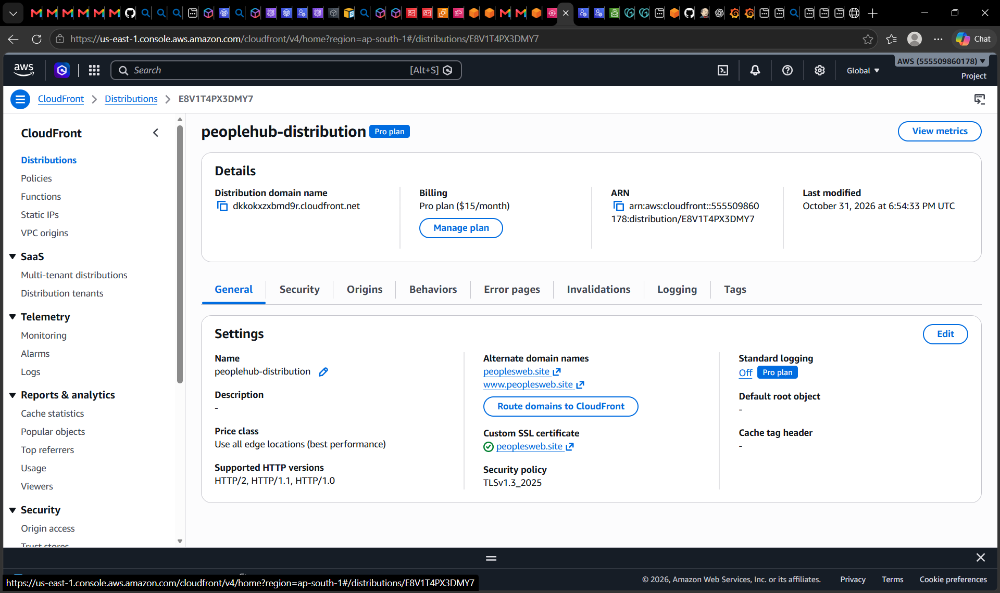

- AWS WAF protects the CloudFront distribution.
- HTTPS is configured using AWS Certificate Manager.
- IAM roles and policies follow least-privilege access.
- EKS workloads use IAM permissions through EKS Pod Identity where configured.
- Kubernetes workloads are isolated using namespaces and service accounts.
- Sensitive application configuration is kept outside source code.

### Database Security

- RDS access is restricted to authorized application resources.
- Database credentials are not stored in public repositories.
- Database access is controlled through network rules and application configuration.

## 11. Monitoring and Observability

The project uses Amazon CloudWatch and Grafana Cloud.

### Amazon CloudWatch

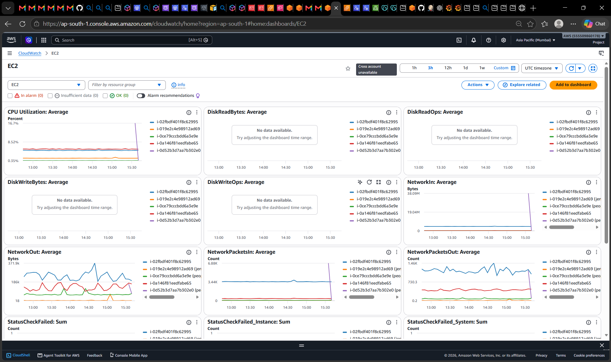
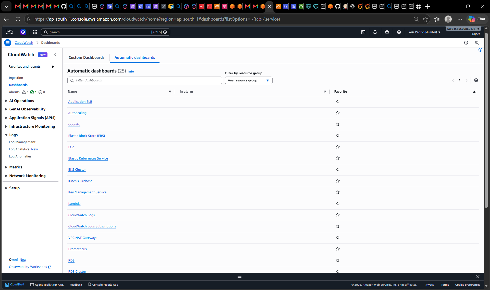
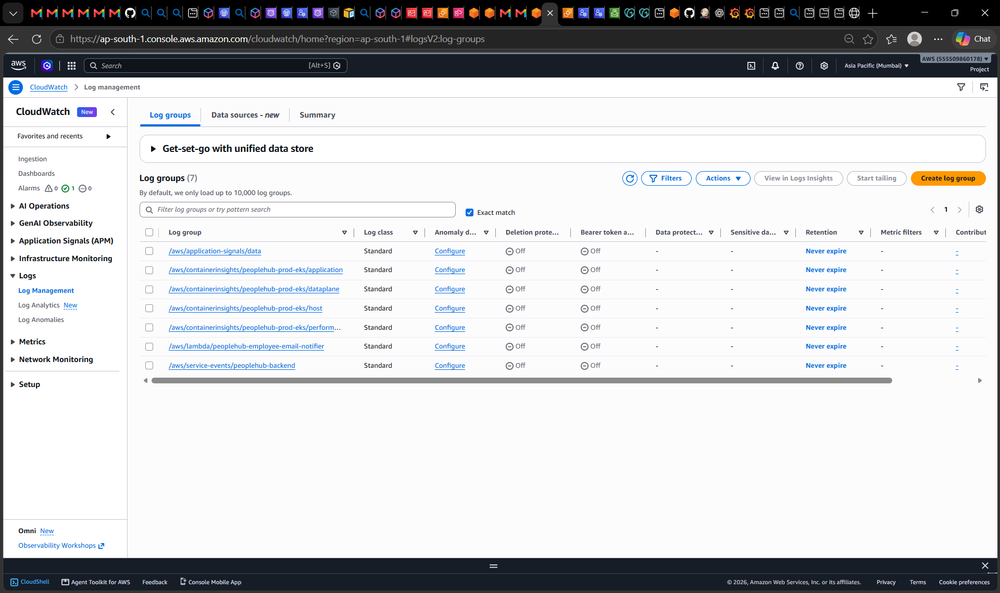

CloudWatch is used to monitor AWS resources and collect metrics and logs.

Monitoring includes:
- EC2 performance.
- EKS and Kubernetes workloads.
- Container and pod metrics.
- Application Signals.
- AWS service metrics.
- Cognito authentication metrics.

### Grafana Cloud

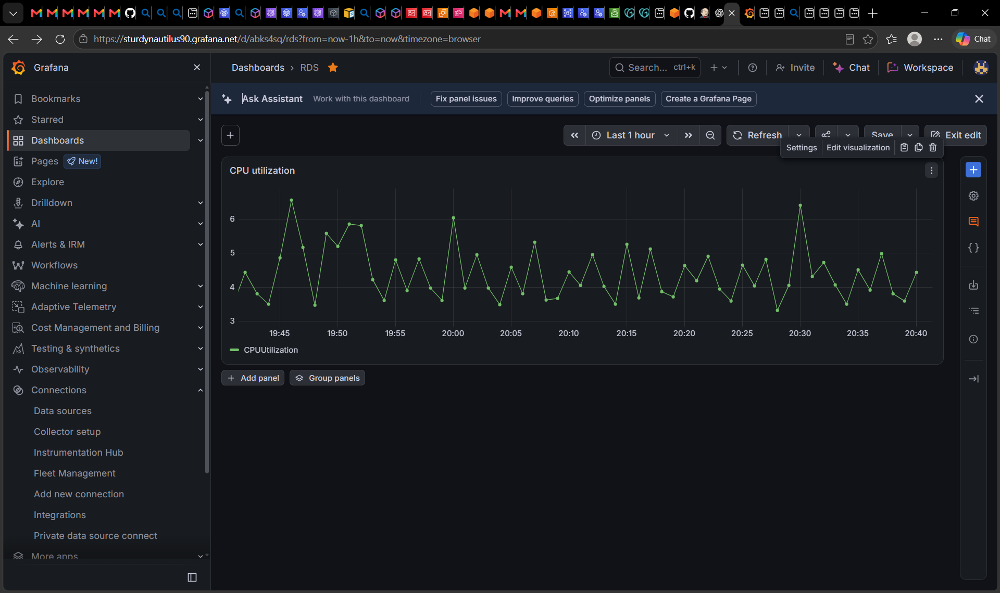
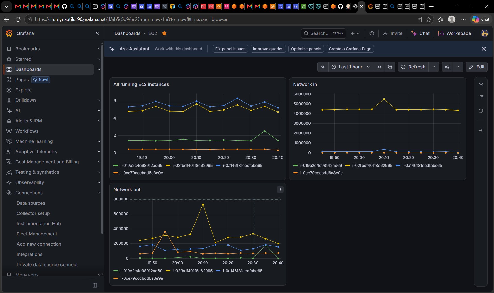
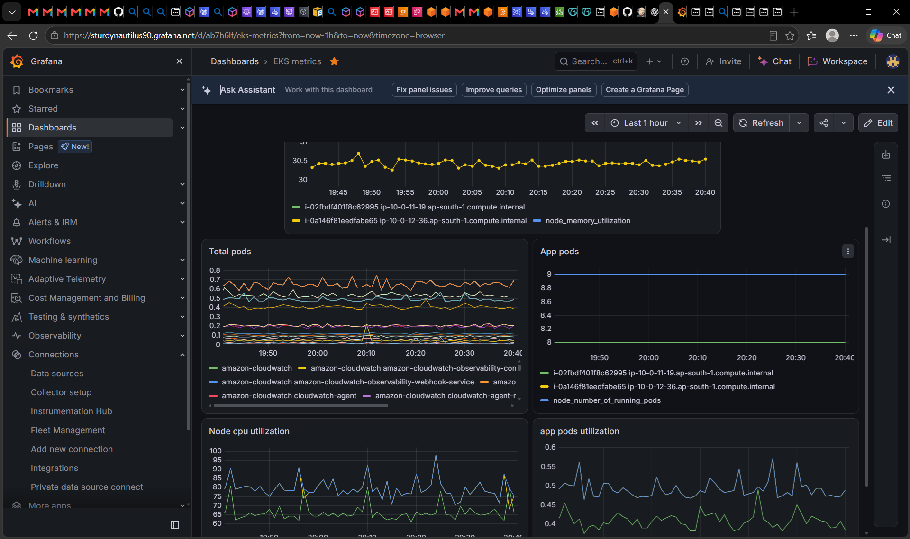
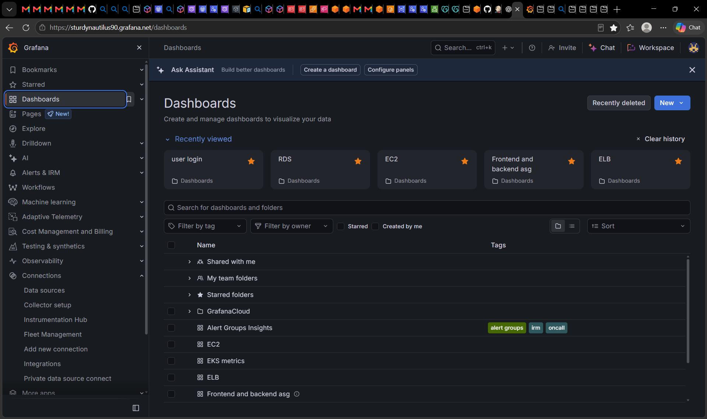
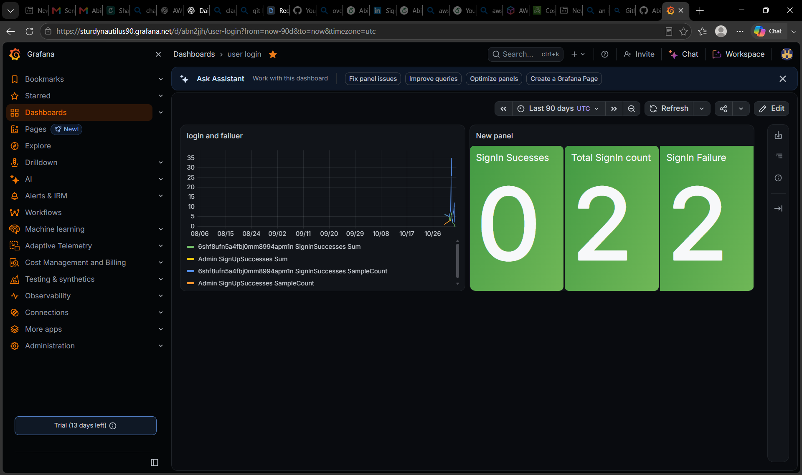

Grafana Cloud connects to AWS CloudWatch as a data source.

It is used to build monitoring dashboards for:
- EC2 CPU and memory metrics.
- EKS cluster and workload metrics.
- Backend application performance.
- Request latency and errors.
- Cognito successful sign-in metrics.
- Cognito sign-up metrics.
- Other available AWS service metrics.

CloudWatch provides the metric data, while Grafana Cloud visualizes the data through dashboards.

## 12. Application Authentication

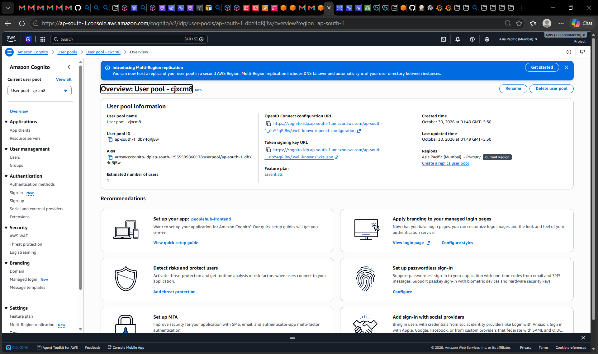

Amazon Cognito is used for user authentication.

The frontend uses the Amazon Cognito authentication SDK to authenticate users.

The backend verifies Cognito access tokens using `aws-jwt-verify`.

Protected employee API routes require valid authentication tokens.

Authentication metrics can be monitored through the AWS/Cognito CloudWatch namespace where the relevant metrics are available.

## 13. Project Benefits

- Three-tier cloud architecture.
- Separate application and infrastructure repositories.
- Automated frontend and backend CI/CD pipelines.
- Infrastructure provisioning through Terraform.
- Containerized backend deployment using Docker and EKS.
- Centralized container image management through ECR.
- DNS management through Route 53.
- CDN and edge protection through CloudFront and WAF.
- HTTPS using AWS Certificate Manager.
- Private backend and database connectivity.
- Asynchronous event processing using SQS and Lambda.
- Email notifications through SES.
- Monitoring using CloudWatch and Grafana Cloud.
- Multi-AZ architecture for improved availability.

## 14. Future Improvements

- Implement automated backup and restore testing.
- Document RDS read replica promotion and failover procedures.
- Add Jenkins automated testing and deployment approval stages.
- Configure centralized application log retention.
- Add CloudWatch alarms for critical application and infrastructure metrics.
- Implement automated vulnerability scanning for container images.
- Introduce infrastructure drift detection.
- Test disaster recovery procedures regularly.

## 15. Conclusion

PeopleHub demonstrates the deployment of a three-tier application on AWS using a combination of cloud infrastructure, container orchestration, database services, networking, security, automation, and monitoring.

The project combines Terraform for infrastructure provisioning, Jenkins for CI/CD, Docker and ECR for container management, Amazon EKS for backend deployment, EC2 for frontend hosting, and AWS managed services for DNS, content delivery, authentication, asynchronous processing, email notifications, and monitoring.

The architecture demonstrates practical implementation of AWS cloud engineering, DevOps automation, infrastructure as code, application deployment,multi-AZ availability and security.

